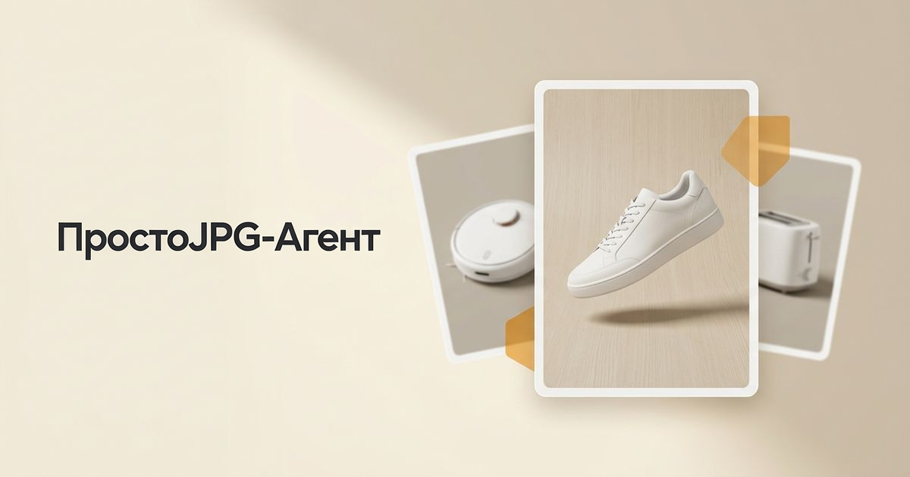

# ПростоJPG-Агент



## Главные команды

| Напишите в чате | Что произойдёт |
|---|---|
| «сделай карточку» или приложите фото | откроется меню из трёх режимов |
| «создай похожую карточку» | режим 1 — похожая карточка, товар узнаваем |
| «замени товар на моём фото и смени лицо» | режим 2 — ваш товар + новое лицо |
| «замени товар, лицо не меняй» | режим 3 — ваш товар, лицо прежнее |
| «меню» | показать кнопки в любой момент |
| «обнови» | обновить плагин до последней версии |

Создавайте карточки товаров для Wildberries и Ozon по загруженным фото.
Специальные промпты и скилы уже встроены.

> ⭐ Если плагин пригодился — [поставьте звезду](https://github.com/8976878-source/ProstoJPG-Agent) на GitHub. Это одна секунда, а для
> автора — основная мотивация развивать проект дальше.

## Быстрый старт

1. Приложите в чат исходные фото карточки (можно ZIP, папку или файл).
2. Выберите режим и напишите команду.

| Режим | Команда в Arena | В Codex | В Claude Code | Что делает |
|---|---|---|---|---|
| 1 | «создай похожую карточку» | `$prostojpg-free-1` | `/prostojpg-free:prostojpg-free-1` | похожая карточка, товар узнаваем |
| 2 | «замени товар на моём фото и смени лицо» | `$prostojpg-free-2` | `/prostojpg-free:prostojpg-free-2` | исходник + ваш товар + новое лицо |
| 3 | «замени товар, лицо не меняй» | `$prostojpg-free-3` | `/prostojpg-free:prostojpg-free-3` | исходник + ваш товар, лицо прежнее |

Артикул и собственный промпт не нужны.

Команды вводить не обязательно. Сразу после установки плагин показывает окно с
готовыми ответами-подсказками — три кнопки режимов. После любого прикреплённого
фото агент спрашивает, что делаем: режим 1 — карточка готова сразу; режим 2 или 3 —
агент попросит ещё одно фото, сам товар.

## Отзыв

Если вы пользуетесь расширением [ПростоJPG в Chrome Web Store](https://chromewebstore.google.com/detail/%D0%BF%D1%80%D0%BE%D1%81%D1%82%D0%BEjpg/djjocjgglhbkcfclclilmamlcoggoole) —
поставьте оценку и короткий отзыв, это помогает проекту. Плагин напоминает об этом
не чаще раза в день и перестаёт после того, как вы оставите отзыв.

## Новый чат в Arena

Arena не хранит плагин между чатами. В новом чате напишите агенту
«Установи https://github.com/8976878-source/ProstoJPG-Agent» — или выполните:

```bash
git clone --depth 1 https://github.com/8976878-source/ProstoJPG-Agent.git /home/user/ProstoJPG-Agent
```

## Обновление

Напишите в чате **«обнови»** — плагин обновится сам.

## Установка

Полная инструкция — [INSTALL.md](INSTALL.md). Для Codex и Claude Code:

```text
codex plugin marketplace add 8976878-source/ProstoJPG-Agent
codex plugin add prostojpg-free@prostojpg-free-marketplace
```

```text
claude plugin marketplace add 8976878-source/ProstoJPG-Agent
claude plugin install prostojpg-free@prostojpg-free-marketplace
```

Зависимость для сборки фото: Python 3.9+ и `pip install "Pillow>=10.4"`.

Версия 1.0.11. Лицензия: MIT (см. LICENSE).
